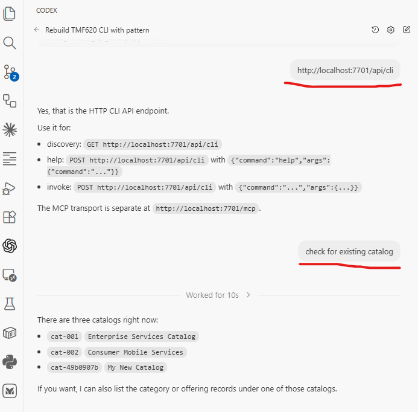

# TMF620 Quick Start

## Docker

Use the TMF620 compose file for the mock API + MCP server.

Once it is up, paste `http://localhost:7701/cli/tmf620/catalogmgt` into a Codex, Claude, or Cursor chat window and start talking to it.

```bash
docker compose -f docker-compose.yml up --build
```

TMF620 stack exposes:

- mock API at `http://localhost:8801/tmf-api/productCatalogManagement/v5`
- MCP transport at `http://localhost:7701/mcp`
- HTTP CLI API at `http://localhost:7701/cli/tmf620/catalogmgt`

The containers use environment overrides rather than rewriting config files. Set them in the matching compose file, or use a `.env` file with Docker Compose



## Without Docker

Use this path for local development with `uv`.

Once it is up, paste `http://localhost:7701/cli/tmf620/catalogmgt` into a Codex, Claude, or Cursor chat window and start talking to it.

### Prerequisites

Install `uv` or ensure Python 3.10+ is available:

```bash
# Install uv
curl -LsSf https://astral.sh/uv/install.sh | sh
# or
pip install uv
```

`uv` will create a local `.venv/` automatically when you run `uv sync`.

### Start The Local Stack

Terminal 1 - start the mock TMF620 API:

```bash
uv sync
uv run tmf620-mock-server
```

The default TMF620 API base URL is `http://localhost:8801/tmf-api/productCatalogManagement/v5`.

Terminal 2 - start the MCP server and HTTP CLI API:

```bash
uv run tmf620-mcp-server
```

The MCP server exposes the HTTP CLI API pattern at `http://localhost:7701/cli/tmf620/catalogmgt`.

### Use The HTTP CLI API

The HTTP CLI API is the command interface for agents and scripts. With the default `tmf620/config/config.json`, it talks to the mock server running on port `8801`.

```bash
# Discover command surface as JSON
curl -s http://localhost:7701/cli/tmf620/catalogmgt

# Request the richer catalog only when needed
curl -s "http://localhost:7701/cli/tmf620/catalogmgt?verbose=true"

# Get per-command help
curl -s -X POST http://localhost:7701/cli/tmf620/catalogmgt \
  -H "Content-Type: application/json" \
  -d '{"command":"help","args":{"command":"offering"}}'

# Leaf help expands to the detailed argument schema
curl -s -X POST http://localhost:7701/cli/tmf620/catalogmgt \
  -H "Content-Type: application/json" \
  -d '{"command":"help","args":{"command":"catalog list"}}'

# Check API health
curl -s -X POST http://localhost:7701/cli/tmf620/catalogmgt \
  -H "Content-Type: application/json" \
  -d '{"command":"health","args":{}}'

# List catalogs
curl -s -X POST http://localhost:7701/cli/tmf620/catalogmgt \
  -H "Content-Type: application/json" \
  -d '{"command":"catalog list","args":{}}'

# Get one catalog
curl -s -X POST http://localhost:7701/cli/tmf620/catalogmgt \
  -H "Content-Type: application/json" \
  -d '{"command":"catalog get","args":{"catalog_id":"cat-001"}}'

# List offerings for a catalog
curl -s -X POST http://localhost:7701/cli/tmf620/catalogmgt \
  -H "Content-Type: application/json" \
  -d '{"command":"offering list","args":{"catalog_id":"cat-001"}}'

# Create an offering
curl -s -X POST http://localhost:7701/cli/tmf620/catalogmgt \
  -H "Content-Type: application/json" \
  -d '{"command":"offering create","args":{"body":{"name":"Premium Ethernet","description":"Managed enterprise access","catalogId":"cat-001","lifecycleStatus":"Active","version":"1.0"}}}'
```

### Start The MCP Server

If you need MCP-native agent integration, run the server separately:

```bash
uv run tmf620-mcp-server
```

The MCP server will be available at `http://localhost:7701`, with MCP transport at `http://localhost:7701/mcp` and health at `http://localhost:7701/health`.

This is a separate adapter from the mock API. The HTTP CLI API and MCP tools both go through this server.

## Measure Context Effects

Run the offline context benchmark to measure progressive discovery, output
projection, and guided error recovery without starting the local stack:

```bash
uv run tmf620-benchmark context
```

The projection section compares full mock API payloads with projected payloads
such as `fields=id,name`. Positive effect means projected responses use fewer
tokens than full responses while preserving the fields needed for the task.

This is an offline payload-size benchmark. It uses the in-process mock API and
synthesized command-error envelopes, so it does not measure network latency,
ASGI middleware overhead, live server serialization cost, or real upstream 5xx
recovery payloads. Use the latency benchmark for live transport measurements.

The default tokenizer is `cl100k_base`. Use `--encoding` to compare another
tiktoken encoding. Baselines are only directly comparable when the encoding
matches.

The current baseline is stored at `benchmarks/context_baseline.json`.

Resource-path commands are also exposed as curated CLI commands:

```bash
curl -s -X POST http://localhost:7701/cli/tmf620/catalogmgt \
  -H "Content-Type: application/json" \
  -d '{"command":"/catalogs list","args":{"fields":"id,name","limit":1}}'

curl -s -X POST http://localhost:7701/cli/tmf620/catalogmgt \
  -H "Content-Type: application/json" \
  -d '{"command":"/catalogs/cat-001 get","args":{"fields":"id,name"}}'
```

Resource-path mode currently supports `/<resource> <action>` and
`/<resource>/<id> <action>`. IDs must be one path segment. If an identifier
contains `/` or another reserved path character, use the canonical command with
an explicit ID argument instead:

```bash
curl -s -X POST http://localhost:7701/cli/tmf620/catalogmgt \
  -H "Content-Type: application/json" \
  -d '{"command":"catalog get","args":{"catalog_id":"cat-001/admin","fields":"id,name"}}'
```

Some user-friendly argument names are normalized before they reach the TMF620
API. For example, `lifecycle_status` is sent as the TMF query parameter
`lifecycleStatus`:

```bash
curl -s -X POST http://localhost:7701/cli/tmf620/catalogmgt \
  -H "Content-Type: application/json" \
  -d '{"command":"/catalogs list","args":{"lifecycle_status":"Active","fields":"id,name"}}'
```

## Configuration

Both the HTTP CLI API and MCP server read `tmf620/config/config.json` by default, then apply `TMF620_API_URL` from Compose or the container environment:

```json
{
  "mcp_server": {
    "host": "localhost",
    "port": 7701,
    "name": "TMF620 Product Catalog API"
  },
  "tmf620_api": {
    "url": "http://localhost:8801/tmf-api/productCatalogManagement/v5"
  }
}
```

You can override the config path with `TMF620_CONFIG_PATH`.

## Notes

- Use compact `GET /cli/tmf620/catalogmgt` for discovery, `GET /cli/tmf620/catalogmgt?verbose=true` only when you need the richer catalog, compact group help for branch selection, and detailed leaf help only when you are ready to invoke.
- The MCP server is now a thin adapter over the same shared client logic.
- The shared command registry lives in `tmf620/commands.py`.
- The MCP adapter in this repo exposes 38 tools.
- If the API is not running at the configured URL, both the HTTP CLI API and MCP server will fail.


